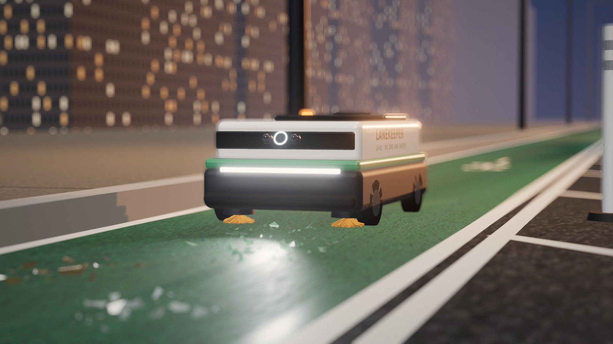
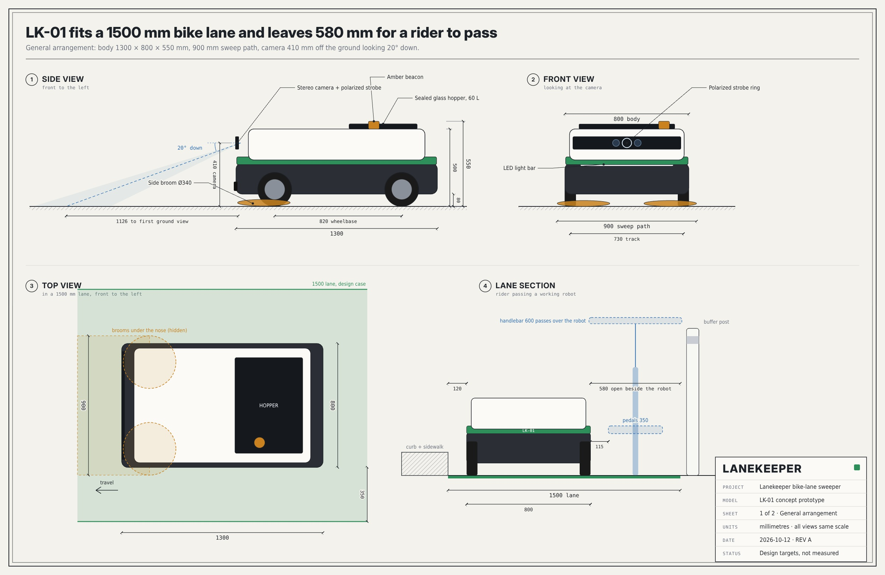
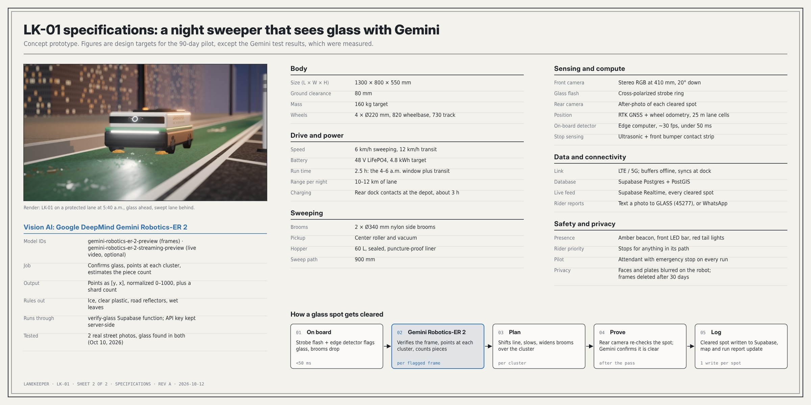

# Lanekeeper

A bike-lane-sized robot sweeper for New York City. It runs protected bike lanes between 4 and 6 a.m., finds broken glass with Google DeepMind's Gemini Robotics-ER models, sweeps it up, and logs every cleared spot to a shared map. Riders report glass by texting a photo to GLASS (45277).



Concept stage. The hardware is a design; the data platform, Gemini glass check and texting webhook are built and deployed to Supabase.

## What's here

| Path | What it is |
| --- | --- |
| `web/index.html` | The Lanekeeper presentation: 3D night run, today vs. Lanekeeper, map strategy, Supabase schema, text GLASS, run report, the pilot ask. One self-contained page |
| `web/run-report.html` | Public run report riders open from a QR code |
| `supabase/migrations/` | Database schema, in order. PostGIS lane cells, detections, cleanups, run reports, rider reports |
| `supabase/seed.sql` | Demo data: the 1st Ave lane cut into 25 m cells and one sample run |
| `supabase/functions/verify-glass/` | Sends a camera frame to Gemini Robotics-ER and records the verdict |
| `supabase/functions/sms-glass/` | Twilio webhook for texted reports (MMS and WhatsApp) |
| `analysis/cost_model.py` | Cost per lane-mile, staffed mini-sweeper vs. robot, three scenarios |
| `docs/prototype/` | Prototype images: render, dimension sheet, spec sheet |
| `prototype/` | Source that renders those images (three.js scene + SVG drawings) |

## Prototype

| | |
| --- | --- |
|  |  |

LK-01 is 1300 × 800 × 550 mm with a 900 mm sweep path. In a 1500 mm lane it leaves 580 mm for a rider to pass. All figures are design targets except the Gemini test, which ran on two real street photos on Oct 10, 2026 and found glass in both.

To re-render: `cd prototype && npm install && npm run drawings && npm run render`.

## Supabase

Project `fvvxmvtoozpxmdkdumrx` (us-east-1). Apply the schema to a fresh project with the Supabase CLI:

```sh
supabase link --project-ref <your-project-ref>
supabase db push
supabase functions deploy verify-glass
supabase functions deploy sms-glass --no-verify-jwt
supabase secrets set --env-file .env   # see .env.example
```

`sms-glass` has JWT checks off because Twilio can't send one; it checks the `X-Twilio-Signature` on every request instead.
`verify-glass` requires a `ROBOT_API_KEY` header on every request, matching the `ROBOT_API_KEY` edge secret (set it alongside the others with `supabase secrets set`). Requests without it — or while the secret is unset — get a 401 before anything is sent to Gemini, and Gemini calls are capped at 60 per hour per function instance (`VERIFY_MAX_PER_HOUR` to change it).


### Not done yet

- `20261010200000_hazard_includes_rider_reports.sql` is written but **not applied** to the live project. It counts rider reports toward each cell's hazard score.
- `sms-glass` needs a Twilio number pointed at its URL and the three Twilio secrets before it handles real texts.
- The run-report page is a snapshot of one run. It does not yet read new reports from the database on its own.

## Cost model

```sh
python3 analysis/cost_model.py
```

Base case: about $18 per lane-mile swept for the robot vs. about $44 for a staffed mini-sweeper. Inputs and sources are in the pilot proposal; the robot build cost is an estimate.
