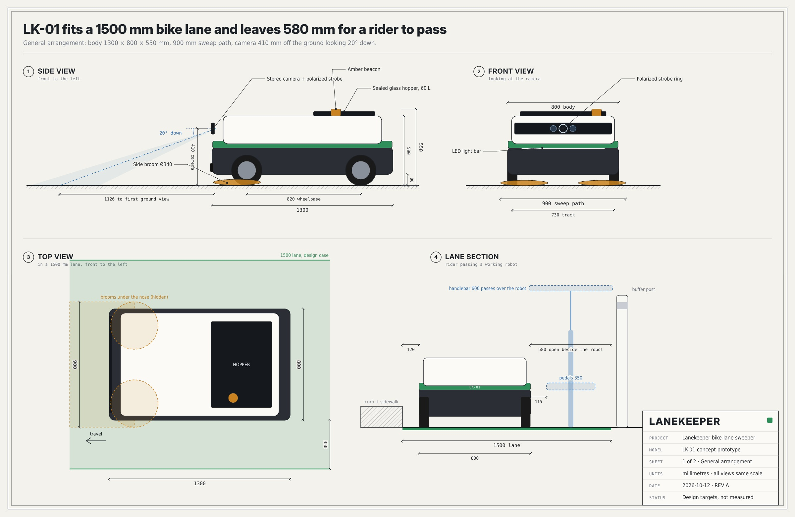
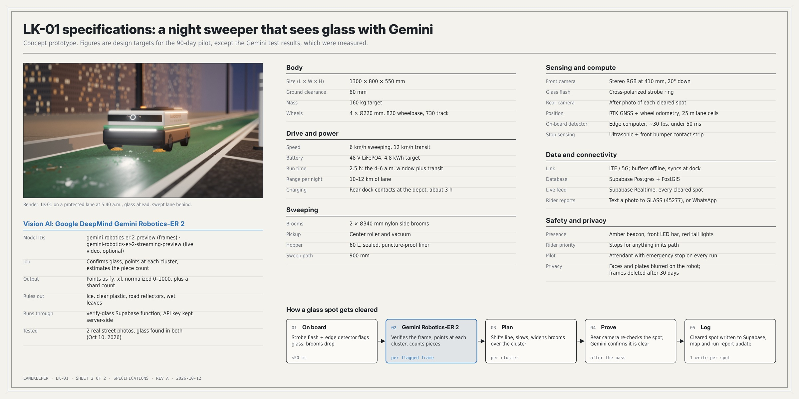

# Lanekeeper

A bike-lane-sized robot sweeper for New York City. It runs protected bike lanes between 4 and 6 a.m., finds broken glass with Google DeepMind's Gemini Robotics-ER models, sweeps it up, and logs every cleared spot to a shared map. Riders report glass by texting a photo to GLASS (45277).


Concept stage. The hardware is a design; the data platform, Gemini glass check and texting webhook are built and deployed to Supabase.

## What's here

| Path | What it is |
| --- | --- |
| `web/` | The Lanekeeper website (Vite): 3D LK-01 model, city lane maps, cost estimator, demo requests. See [Website](#website) |
| `web/public/presentation/` | The original Lanekeeper presentation, served at `/presentation/` |
| `web/public/run-report/` | Public run report riders open from a QR code, served at `/run-report/` |
| `supabase/migrations/` | Database schema, in order. PostGIS lane cells, detections, cleanups, run reports, rider reports |
| `supabase/seed.sql` | Demo data: the 1st Ave lane cut into 25 m cells and one sample run |
| `supabase/functions/verify-glass/` | Sends a camera frame to Gemini Robotics-ER and records the verdict |
| `supabase/functions/sms-glass/` | Twilio webhook for texted reports (MMS and WhatsApp) |
| `supabase/functions/request-demo/` | Demo-request intake for the website: validation, honeypot, rate limits |
| `analysis/cost_model.py` | Cost per lane-mile, staffed mini-sweeper vs. robot, three scenarios |
| `docs/prototype/` | Prototype images: render, dimension sheet, spec sheet |
| `prototype/` | Source that renders those images (three.js scene + SVG drawings) |

## Website

**Live:** https://pauloes-btechs.github.io/lanekeeper/ (deployed by `.github/workflows/pages.yml` on every push to `main`)

A single page for city transportation and sanitation teams: the LK-01 robot in 3D (orbit, exploded view, dimensions, labeled parts), how a glass spot gets cleared, a map of each city's existing protected bike lanes with a fleet and cost estimate, and a demo request form.

```sh
cd web
npm install
npm run dev        # http://localhost:5173/lanekeeper/
npm test           # estimator pinned to analysis/cost_model.py, model dimensions, form rules, geometry
npm run lint
npm run build      # static site in web/dist
npm run model      # re-export public/models/lk-01.glb after editing src/robot/model.js
npm run data       # re-download city lane data (needs open network; CI does this monthly)
```

**3D model.** `web/src/robot/model.js` builds LK-01 from parametric three.js geometry at true scale and `npm run model` exports it to `public/models/lk-01.glb`. The site loads that GLB.

**City data.** `web/scripts/cities.json` lists each city's official open-data source and the filter that keeps only existing protected lanes. `npm run data` downloads them, simplifies the lines, and computes lane-miles from the geometry (never typed by hand). The `City lane data` workflow re-runs this monthly and opens a PR with any changes. Current coverage: New York, San Francisco, Washington DC, Chicago, Seattle, Portland, Philadelphia, Minneapolis and Los Angeles. Boston is left out until its protected-lane codes are confirmed.

**Demo requests** go to the `request-demo` edge function, which validates the form, drops honeypot submissions, rate-limits by a salted hash of IP and email, and writes to `public.demo_requests`. That table has no public access; read it in the Supabase dashboard or with the service role.

## Prototype

| | |
| --- | --- |
|  |  |

LK-01 is 1300 × 800 × 550 mm with a 900 mm sweep path. In a 1500 mm lane it leaves 580 mm for a rider to pass. All figures are design targets except the Gemini test, which ran on two real street photos on Oct 10, 2026 and found glass in both.

To re-render: `cd prototype && npm install && npm run drawings && npm run render`.

## Supabase

Project `fvvxmvtoozpxmdkdumrx` (us-east-1). Apply the schema to a fresh project with the Supabase CLI:

```sh
supabase link --project-ref <your-project-ref>
supabase db push
supabase functions deploy verify-glass
supabase functions deploy sms-glass --no-verify-jwt
supabase functions deploy request-demo --no-verify-jwt
supabase secrets set --env-file .env   # see .env.example
```

`sms-glass` has JWT checks off because Twilio can't send one; it checks the `X-Twilio-Signature` on every request instead.
`verify-glass` requires a `ROBOT_API_KEY` header on every request, matching the `ROBOT_API_KEY` edge secret (set it alongside the others with `supabase secrets set`). Requests without it — or while the secret is unset — get a 401 before anything is sent to Gemini, and Gemini calls are capped at 60 per hour per function instance (`VERIFY_MAX_PER_HOUR` to change it).


### Not done yet

- `20261010200000_hazard_includes_rider_reports.sql` is written but **not applied** to the live project. It counts rider reports toward each cell's hazard score.
- `sms-glass` needs a Twilio number pointed at its URL and the three Twilio secrets before it handles real texts.
- The run-report page is a snapshot of one run. It does not yet read new reports from the database on its own.

## Cost model

```sh
python3 analysis/cost_model.py
```

Base case: about $18 per lane-mile swept for the robot vs. about $44 for a staffed mini-sweeper. Inputs and sources are in the pilot proposal; the robot build cost is an estimate.
